# 实际界面截图

截图来自 iPhone 17 Pro / iOS 26.0 上运行的 Flutter 应用，由集成测试自动生成。包含 12 个 Pixso 原稿对应界面和 8 个补充交互状态，共 20 张 PNG。

`integration_test` 捕获 Flutter 应用视图，因此系统状态栏图标不包含在这些截图中；系统安全区保留。各图保留 1206 × 2622 原始截图分辨率。Pixso 原稿另存于 [design](design/)，不会混作应用截图。

## 浏览与发现

| 最新作品 | 推荐 | 动态 |
| --- | --- | --- |
| [01-feed-new.png](screenshots/01-feed-new.png) 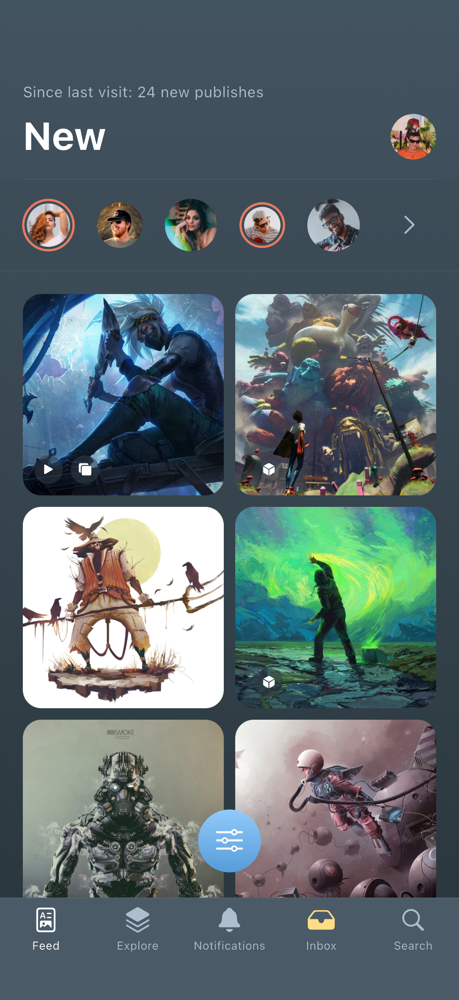 | [02-feed-recommended.png](screenshots/02-feed-recommended.png) 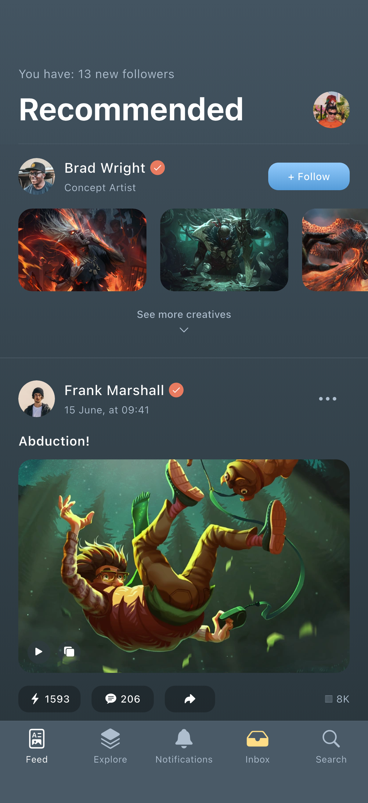 | [03-feed-activity.png](screenshots/03-feed-activity.png) 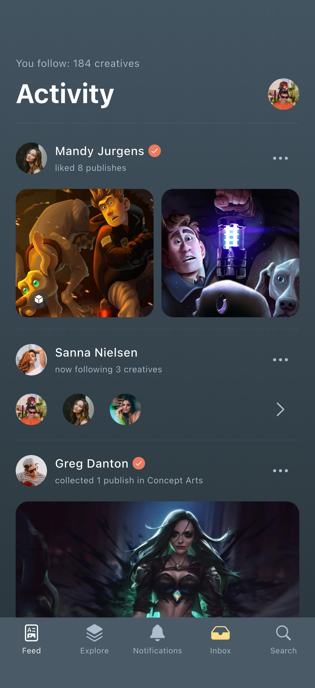 |

| 筛选面板 | 筛选内搜索 | 探索 |
| --- | --- | --- |
| [04-feed-filter.png](screenshots/04-feed-filter.png) 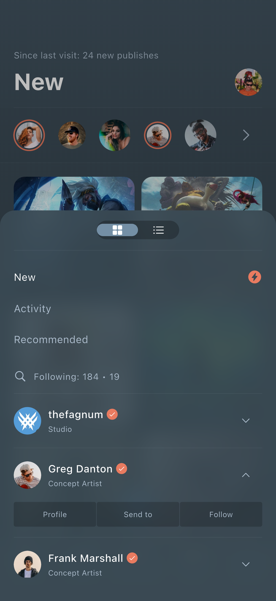 | [05-filter-search.png](screenshots/05-filter-search.png) 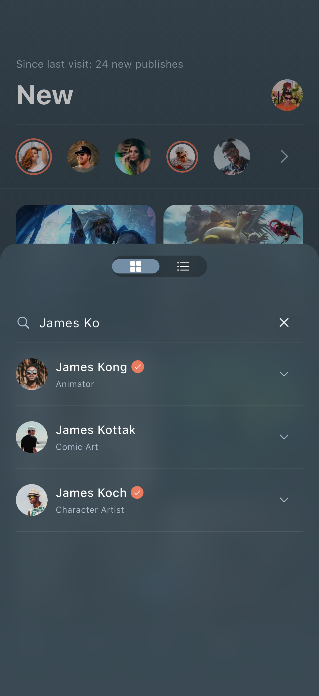 | [06-explore.png](screenshots/06-explore.png) 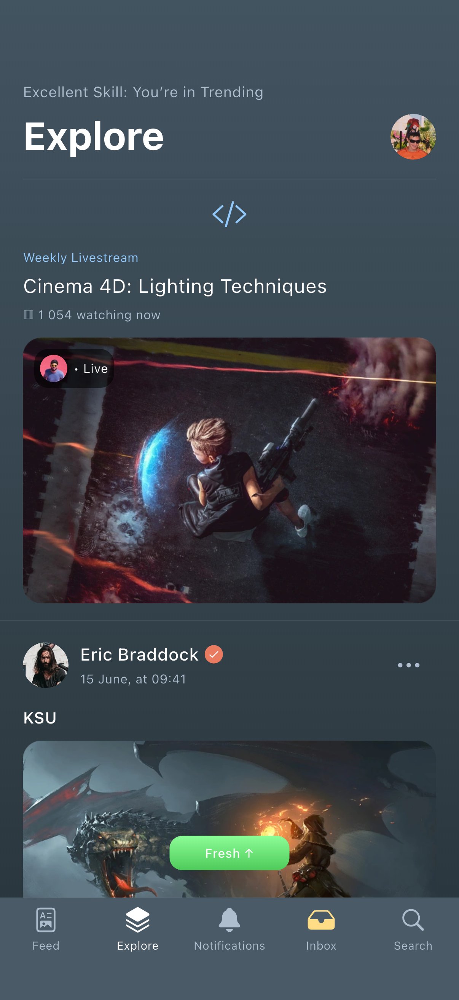 |

## 作者、会话与作品

| 个人主页 | 聊天 | 作品详情 |
| --- | --- | --- |
| [07-profile.png](screenshots/07-profile.png) 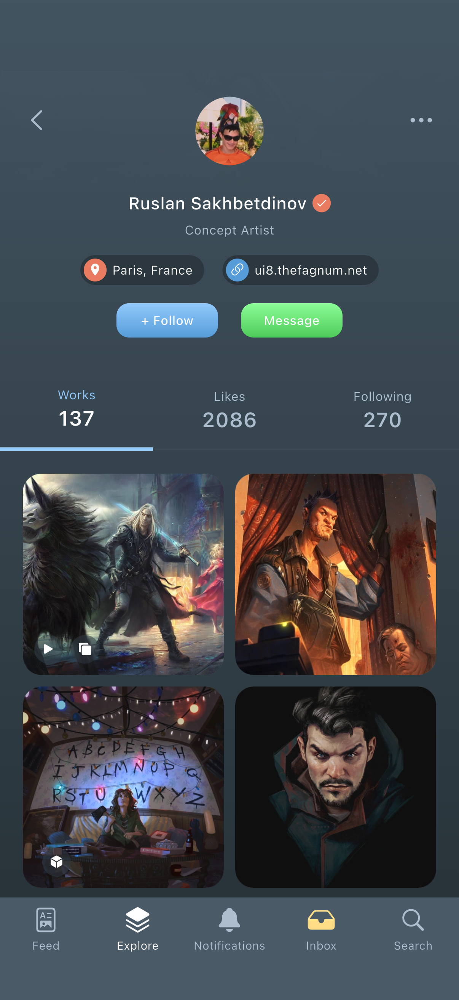 | [08-chat.png](screenshots/08-chat.png) 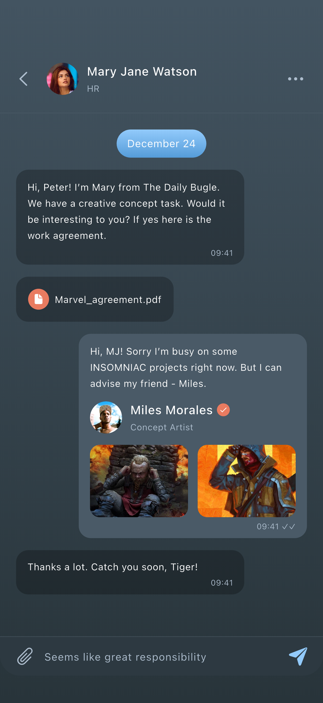 | [09-work.png](screenshots/09-work.png) 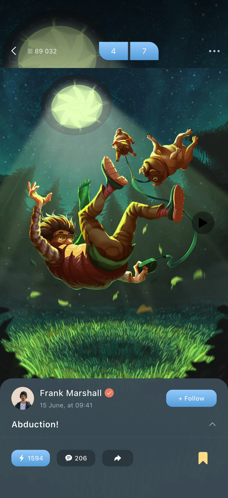 |

| 作品说明 | 评论面板 | 播放器预览 |
| --- | --- | --- |
| [10-work-description.png](screenshots/10-work-description.png) 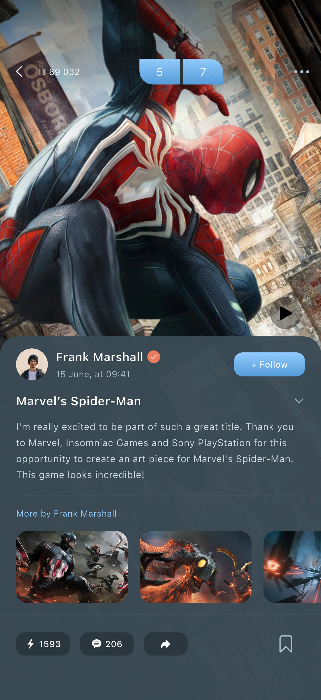 | [11-comments.png](screenshots/11-comments.png) 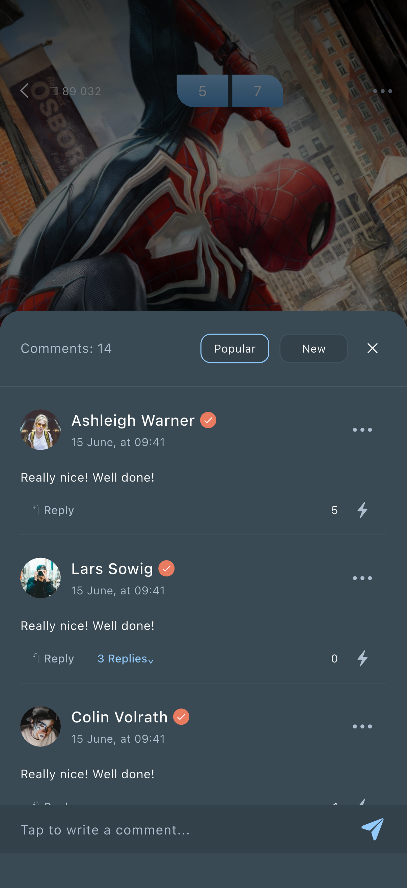 | [12-video.png](screenshots/12-video.png) 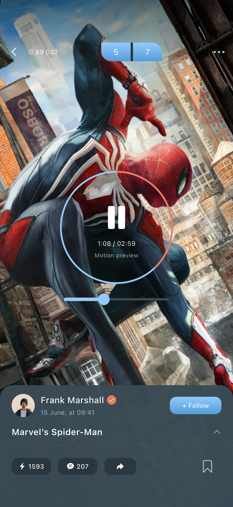 |

## 补充界面与操作结果

| 会话列表 | 全局搜索 | 作品搜索结果 |
| --- | --- | --- |
| [13-inbox.png](screenshots/13-inbox.png) 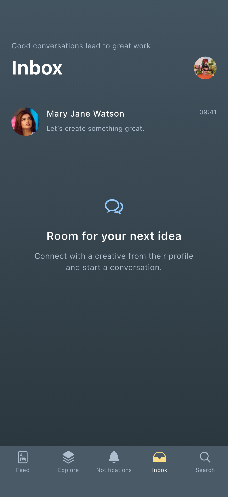 | [14-search.png](screenshots/14-search.png) 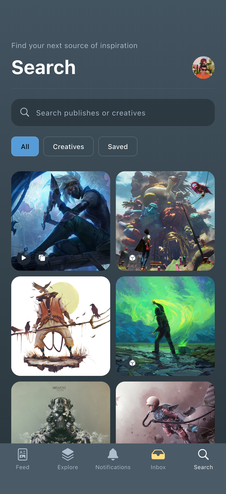 | [15-search-results.png](screenshots/15-search-results.png) 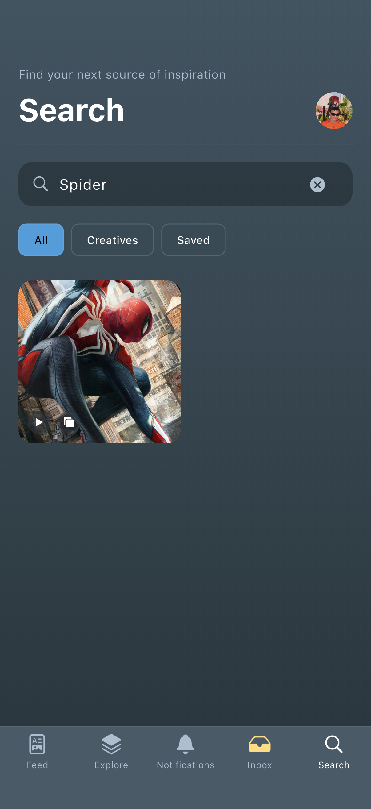 |

| 列表模式 | 作品菜单 | 评论提交后 |
| --- | --- | --- |
| [16-feed-list.png](screenshots/16-feed-list.png) 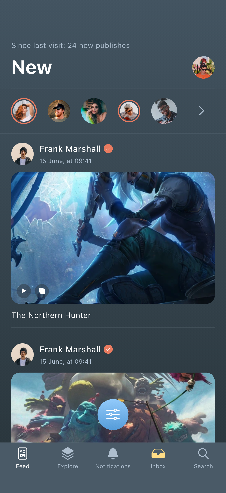 | [17-explore-menu.png](screenshots/17-explore-menu.png) 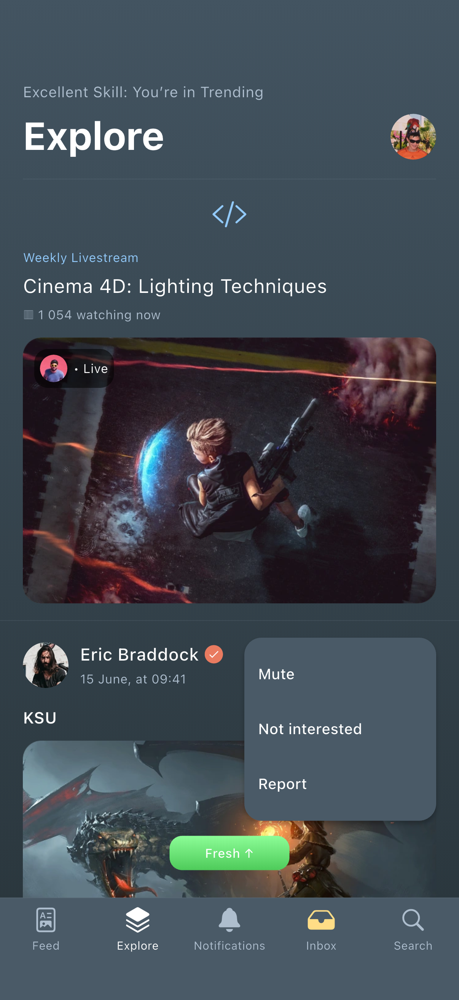 | [18-comment-sent.png](screenshots/18-comment-sent.png) 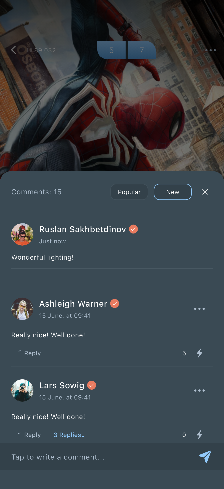 |

| 消息发送后 | 收藏筛选 |
| --- | --- |
| [19-chat-sent.png](screenshots/19-chat-sent.png) 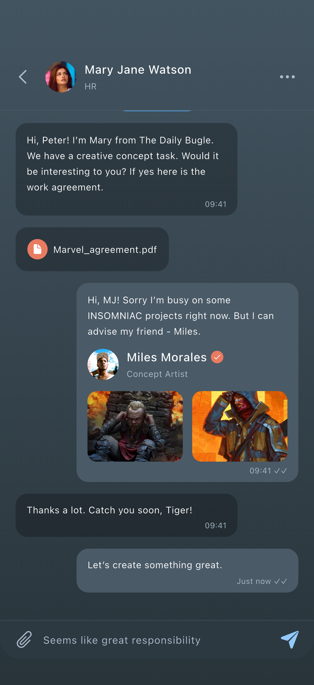 | [20-saved.png](screenshots/20-saved.png) 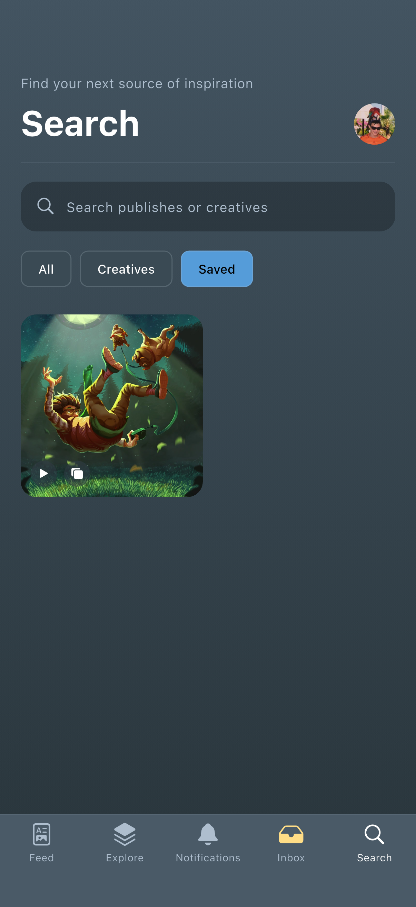 |
